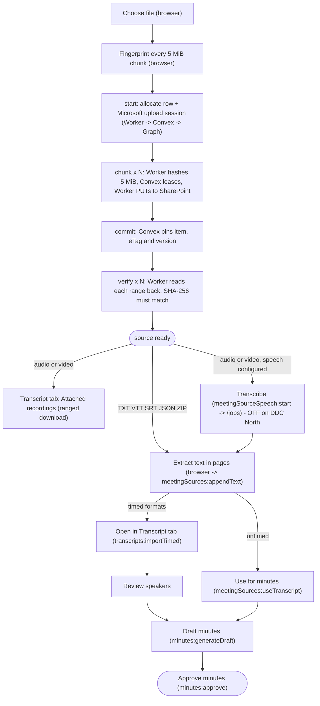

# Meeting source files: from "Choose file" to minutes

This walks through what happens to a file chosen on a meeting's **Meeting source
files** card, stage by stage, up to approved minutes. It covers each file type,
where each stage runs, who may do it, what is stored where, the limits, and what
happens on failure. It also says what works on the DDC North deployment
(`https://societyer-ddcnorth.pages.dev`) today, and how automatic transcription
could be turned on.

Related: [meeting-source-storage.md](meeting-source-storage.md) (storage design,
Microsoft qualification, deployment), [meeting-transcript-workspace.md](meeting-transcript-workspace.md)
(Transcript tab), [local-ai.md](local-ai.md) (on-device AI),
[decision A1](decisions/2026-10-17-meetings-ai-assumptions.md#a1-working-transcripts-are-for-minute-takers-only).

## The short version

| You upload | What you get | What you do next |
| --- | --- | --- |
| **VTT or SRT** (Teams, Zoom, captions) | The original in SharePoint, its text in pages, and a timed transcript ready to open | **Open in Transcript tab**, review speakers, **Draft minutes from transcript** |
| **Whisper JSON** | The same as VTT, with word timings and diarization labels | The same |
| **Whisper ZIP** | The archive in SharePoint, text from its transcript entry, and a timed offer if it holds JSON, VTT or SRT | The same; the recording inside the ZIP is not extracted |
| **TXT** | The original and its text in pages. No timings. | **Read transcript**, then **Use for minutes**, then draft from the transcript card |
| **Audio or video** | The original in SharePoint, playable in the Transcript tab | **Play in Transcript tab**. On DDC North, no automatic transcript: upload an export as well |

On DDC North today, everything above works **except automatic transcription of
recordings**. It is off because the deployment has no speech service configured
(`MEETING_TRANSCRIPTION_ENDPOINT` and `MEETING_TRANSCRIPTION_KEY` are unset), as
the owner asked ("stay serverless, hold off on the OpenAI key"). AI minutes
drafting has no AI provider either, so **Draft minutes** gives the rule-based
draft (motions, action items and times picked out of the text), which a person
then edits.

## Diagram



Plain-text version:

```
browser ──fingerprint──► Worker ──control──► Convex ──Graph──► SharePoint (original)
   │                       ▲  bytes (≤5 MiB) ───────────────────► upload session
   │                       └──── readback, SHA-256 per range ◄──┘
   ├─ text formats: extract ──► Convex meetingSourceText (pages) ──► Use for minutes ─┐
   ├─ timed formats: parse ──► transcripts (segments, speakers) ──► Review speakers ──┤
   └─ recordings ─────────────► Attached recordings (play)  [speech: off on DDC North]│
                                                    Draft minutes ◄───────────────────┘
                                                    Approve minutes
```

## Who can do what

The roles are the defaults in `shared/functions/permissions.ts`.

| Action | Needs | Owner | Admin | Director | Member | Viewer |
| --- | --- | --- | --- | --- | --- | --- |
| See the card, upload, list, download originals, cancel | `meetings:write` | yes | yes | yes | no | no |
| Write into an upload, import its text, start speech | `meetings:write`, and be the uploader | uploader | uploader | uploader | no | no |
| Read a source's text (**Read transcript**), **Open in Transcript tab**, **Play in Transcript tab** | `meetings:write`, plus `meetings:read` and `minutes:write` (A1) | yes | yes | yes | no | no |
| **Use for minutes** | `meetings:write` and `minutes:write` | yes | yes | yes | no | no |
| Transcript tab, Review speakers, links | read: `minutes:write` (A1). Edits: `meetings:write`. Links: `minutes:write` | yes | yes | yes | no | no |
| **Draft minutes from transcript** | `minutes:write` | yes | yes | yes | no | no |
| Approve minutes | `minutes:approve` | yes | yes | no | no | no |

Members and Viewers never see the card, the source text or the transcript. They
read the minutes (decision A1). In the default roles every `meetings:write` role
also holds `minutes:write`. The card still checks transcript access separately,
so a future role with one and not the other can't read transcripts through the
card. `meetingSources:textPage` checks the A1 rule on the server too.

## Stages

### 1. Choose file and fingerprint (browser)

- **Where:** `MeetingSourcesCard` → `uploadMeetingSource` → `uploadMeetingSourceWith`
  (`src/lib/meetingSourceTransfer.ts`).
- **What:** the name and size are checked (1 byte to 500,000,000 bytes, and TXT, VTT, SRT,
  JSON, ZIP or a recording extension). Then every 5 MiB chunk is hashed (SHA-256),
  and a fingerprint is made from the ordered chunk hashes, name and size. Memory
  stays bounded: one chunk at a time.
- **Stored:** nothing yet.
- **Failure:** a wrong type or size is refused before any request. **Pause** aborts.

### 2. Allocate and open an upload session (Worker → Convex → Microsoft Graph)

- **Where:** Worker `societyer-ddcnorth-meeting-transfer` (`workers/meeting-transfer/index.ts`)
  forwards `start` to Convex `POST /meeting-sources/control` (`convex/meetingSourceHttp.ts`)
  with the user's sign-in token and the private broker key.
- **What:** Convex checks the broker key, the signed-in user and `meetings:write`
  (`internal.meetingSources.allocate`). The same uploader, meeting and fingerprint
  returns the existing row, which is how **resume** works. Otherwise a row is
  created with an allocated name, `societyer-meeting-<uuid>.<ext>`. Convex then
  checks the approved SharePoint site and drive, and asks Graph for an upload
  session with `conflictBehavior: fail`.
- **Stored:** Convex `meetingSources` row: meeting, uploader, name, size, kind,
  fingerprint, status `uploading`, upload session URL and its expiry. The session
  URL never leaves Convex and the Worker.
- **Limits:** control requests are at most 8 KB. The Worker only accepts the site's
  origin (`SITE_ORIGIN`).
- **Failure:** a Member, another workspace or a signed-out user is refused before
  any Microsoft call. Errors are generic, with no Microsoft bodies or URLs.

### 3. Transfer chunks (browser → Worker → SharePoint)

- **Where:** the browser PUTs each chunk to the Worker at the offset the server
  last acknowledged. The Worker hashes it, asks Convex for a **lease** (`prepare`),
  PUTs it to the SharePoint upload URL with `Content-Range`, then reports `ack`.
- **What:** the lease records the chunk's digest **before** the transfer, and holds
  for 90 seconds. Only the uploader can take a lease.
- **Stored:** in SharePoint, the partial upload. In Convex, `offset` and the chunk
  digest manifest (`hashes`).
- **Limits:** bodies are at most 5 MiB. One chunk transfers at a time per source.
- **Failure and resume:** close the browser, then choose the same complete file
  again. The fingerprint finds the row and `resume` asks Microsoft for its next
  expected offset. If an in-flight chunk's acknowledgement was lost, wait 90
  seconds (the lease). The server then advances only to what Microsoft
  acknowledged, against the digest it staged. Microsoft upload sessions expire:
  after that, cancel and upload again. **Cancel upload** removes access first, then
  deletes the remote session.

### 4. Commit and verify (Convex → Graph, Worker readback)

- **What:** when the offset reaches the size, Convex checks the SharePoint item
  (size, name, drive, file) and pins its item id, eTag and version (`verifying`).
  `verify` then reads each 5 MiB range back from SharePoint through the Worker. Each
  range's SHA-256 must equal the digest computed on the way in. Only then is the
  source `ready`.
- **Stored:** item id, eTag and version id on the row. `uploadUrl` is cleared.
- **Failure:** a mismatch fails verification ("Stored file checksum mismatch").
  Downloads before `ready` are refused.

### 5. Extract text into pages (browser → Convex), text formats only

- **Where:** `importMeetingSourceText` (`src/lib/meetingTranscriptImport.ts`) runs in
  the browser, from the same `File`, and calls `meetingSources:appendText`.
- **What:** TXT is kept as is. VTT and SRT keep the cue text and `<v Speaker>` names
  and drop the timings (the original keeps them). Whisper JSON takes `text` or
  `segments[].text` (with speakers). A ZIP gives one transcript entry, preferring
  TXT, then VTT, SRT, JSON. The last chunk is marked complete, so a partial import
  is never usable.
- **Stored:** Convex `meetingSourceText` rows of at most 48,000 bytes (12,000
  characters) each. The row records `textChunks`, `textBytes` and `textComplete`.
- **Limits:** JSON up to 16 MiB to parse. ZIP: 1,000 entries, a 2 MiB directory, 1 GB
  expanded, no encrypted or unsafe paths, CRC checked. Nested archives and embedded
  recordings are not unpacked.
- **Failure:** the original stays attached. Choosing the same file again resumes at
  the next chunk. Chunks already stored are accepted again only if identical.

### 6. Timed-transcript offer: "Open in Transcript tab" (browser → Convex)

- **Where:** `timedTranscriptOffer` (`src/features/meetings/transcript/timedImportOffer.ts`)
  parses the chosen file in the browser while the upload runs.
- **What:** VTT, SRT and Whisper JSON up to 16 MiB, or the first JSON, VTT or SRT
  entry that parses in a ZIP. Once the original is attached, the card offers
  **Open in Transcript tab** as its primary action. It asks "Replace working
  transcript?" if one exists, calls `transcripts:importTimed`, and opens
  `?tab=transcript`, with Review speakers when there are two or more labels or a
  raw `SPEAKER_n` label.
- **Stored:** Convex `transcripts` row: `segments[]` (speaker, text, start, end,
  optional words), a fresh `speakers[]` map, and regenerated `text`. An unapproved
  minutes draft gets the text too. Approved minutes are never changed.
- **Limits:** 20,000 segments. Rows over 700 KB drop word timings and keep line
  timings.
- **Failure:** the offer is held in the page only. After a reload, choose the same
  file again: the upload is found as already done, text chunks replay, and the
  offer returns.

### 7. Use for minutes (untimed text and speech results)

- **What:** `meetingSources:useTranscript` joins the pages and replaces the working
  transcript with untimed text (`provider: "uploaded-transcript"`, no segments).
  It also updates an unapproved draft's transcript copy.
- **Limits:** completed text of at most 600 KB. Larger text stays readable in pages:
  paste a relevant excerpt into the transcript card.
- **Caution:** on a timed transcript this replaces the segments and speaker names
  with plain text. The confirmation says so. For timed files, use **Open in
  Transcript tab** instead.

### 8. Transcript tab: Review speakers and playback

- **Review speakers** suggests combining labels that differ only by case or spacing,
  and naming labels that match attendees. Combining is non-destructive and can be
  undone. Naming rewrites `text` as `Name: text`, so drafting sees real names.
- **Attached recordings** (meeting editors, broker-configured hosted deployments)
  lists the meeting's `ready` recordings. **Play in Transcript tab** on the card
  opens this list. **Download and play** fetches the recording through the Worker in
  verified 5 MiB ranges into memory, then plays it like a file opened from the
  device. Recordings over 200 MB play without a waveform and are held in memory.
- **Open recording** plays a file from the device instead. It is never uploaded.

### 9. Draft minutes

- **Server workspace (DDC North):** **Draft minutes from transcript** calls
  `minutes:generateDraft` with the named transcript text. It uses the workspace AI
  provider (Settings → AI setup) or the deployment's `ANTHROPIC_API_KEY`/`OPENAI_API_KEY`.
  With neither, as on DDC North today, it saves the **rule-based draft**: "I move…"
  lines become motions (with seconder and outcome), "Action item:" lines become
  action items, and the opening and adjournment times are read from the text.
- **Browser-local workspace or desktop app:** the on-device model in Settings →
  On-device AI, if set up. It is not available on the hosted site.
- Drafting refuses adopted minutes, and drafts whose sections hold recorded content
  (named in the message; the meeting template's untouched defaults don't count).
  It asks before replacing a started draft.
- Motions and action items can be linked to transcript time ranges
  (`transcripts:linkMinutesItem`).

### 10. Approval

Approving sets `approvedAt` and needs `minutes:approve` (Owner and Admin by
default). After that, drafting, imports, **Use for minutes** and speaker renames no
longer change the minutes. Change them with an amendment.

## Automatic transcription of recordings (server path, off on DDC North)

When `MEETING_TRANSCRIPTION_ENDPOINT` and `MEETING_TRANSCRIPTION_KEY` are set on
Convex, recordings get **Transcribe** (uploader only, with a usage-charges
confirmation). `convex/meetingSourceSpeech.ts` implements this contract:

1. `POST {origin}/jobs` with `Authorization: Bearer <key>` and JSON
   `{ id, downloadUrl, size, fileName, hashes }`. `downloadUrl` is a short-lived,
   pre-signed SharePoint URL for the pinned original. `hashes` is the SHA-256 manifest
   of its 5 MiB chunks, so the processor can verify what it fetched. Any 2xx accepts.
   A lost response is recovered by polling.
2. `GET {origin}/jobs/{id}` returns `{ "status": "processing" }`,
   `{ "status": "failed" }`, or `{ "status": "complete", "text": "…" }`. It is
   polled 15 seconds after start, then every 60 seconds.
3. The text (at most 16,000,000 bytes, response at most 18 MB) is stored in pages,
   like an import. It is then used through **Use for minutes**.

Rules: the endpoint must be HTTPS with no credentials in the URL, and the key at
least 32 characters. `/jobs` is resolved from the endpoint's **origin**, so a path
in `MEETING_TRANSCRIPTION_ENDPOINT` is ignored. No redirects are followed. A job
that is still unknown (404) after 5 minutes fails, and so does any job after 2
hours. If the uploader loses access, the job stops at the next poll. One job runs
per source, and repeated **Transcribe** clicks don't create more.

Limitation: the contract returns plain text. Speech results arrive untimed, with no
segments or speaker labels, so they don't open in the Transcript tab with timings.
Supporting that would mean extending the contract with Whisper-style `segments`.

The older `transcripts:runPipeline` (Whisper via `OPENAI_API_KEY` or `WHISPER_ENDPOINT`,
reading Convex `_storage`) doesn't apply to DDC North: native file storage is
disabled there, so the page refuses audio uploads to Convex.

## How to turn on transcription: options

| Option | Serverless? | New key or vendor | Timed and speakers | Engineering | Fits DDC North now |
| --- | --- | --- | --- | --- | --- |
| **(d) Export VTT from Teams, Zoom or Otter and upload it** | yes | none | yes: Teams and Zoom VTT carry names | none | **yes** |
| **(c) Transcribe on the editor's computer, upload the export** | yes, for the deployment | none (local Whisper) | yes (Whisper JSON, VTT or SRT) | none (third-party apps, or the Societyer desktop app's **Export**) | yes |
| **(a) Managed async speech service behind `/jobs`** | yes, with a small adapter Worker | yes (speech vendor) | text only today | an adapter Worker, plus optionally a timed contract | later |
| **(b) Workspace AI provider key (OpenAI Whisper)** | partly | yes (OpenAI) | yes, per request | significant | no |

**(d) Export from the meeting platform.** Teams (meeting recap → Transcript →
Download as .vtt), Zoom cloud recordings (audio transcript `.vtt`), and Otter
(export TXT or SRT) already transcribe and label speakers. Upload the export, then
**Open in Transcript tab**: the names are already there. Attach the recording too,
for playback. No new service, key, cost or data flow. DDC North already runs on
Microsoft 365. This works today and needs nothing new. It only covers meetings
held or recorded on those platforms.

**(c) Transcribe on the editor's computer.** For an in-person recording, run a
Whisper app on the computer: whisper.cpp, MacWhisper, a WhisperX server for
speaker labels, or speaches. Export VTT, SRT or Whisper JSON, then upload it.
Audio stays on that computer until the editor uploads the original. The Societyer
desktop app's **Transcribe on this device** works only in its local workspace, and
the hosted site (including the desktop app's online mode) doesn't offer on-device
speech. To move such a transcript: **Transcribe on the desktop app → Export VTT →
upload on the hosted site**. In the desktop app's local workspace, transcribe the
recording, review speakers, then choose **Export → WebVTT** (or **Whisper JSON**,
which also keeps word timings) in the Transcript tab toolbar. On the hosted site, upload
the file under Meeting source files and choose **Open in Transcript tab** (or use
**Import transcript** in the tab). Timings and the speaker names assigned on the
desktop come across; see [Transcript files (Export)](meeting-transcript-workspace.md#transcript-files-export),
including how in-camera parts are left out.

**(a) A managed asynchronous speech service.** This is the path the code is built
for. No vendor speaks this exact `/jobs` contract, so a small serverless adapter
(a Cloudflare Worker, like the transfer Worker) would be needed. It would accept
`POST /jobs`, hand `downloadUrl` to a vendor's URL-based batch transcription,
map `GET /jobs/{id}` to the vendor's status, and return the text. Candidates take
a media URL and large files, for example Azure AI Speech batch transcription
(stays with Microsoft, and has Canadian regions), AssemblyAI, Deepgram or Rev.ai.
Before choosing one, check its current file-size limits, retention, data
residency and price. Tradeoffs: per-minute cost; recordings leave the Microsoft
tenant unless the vendor is Azure; one more Worker and secret to run; results are
untimed until the contract carries segments. Note that the earlier processor
(an ffmpeg container feeding OpenAI) was removed at the owner's request.

**(b) The workspace AI provider key.** The workspace AI provider (Settings → AI
setup) is only used for minutes drafting and chat. Speech doesn't use it. OpenAI's
transcription endpoint accepts at most 25 MB per request, so a recording up to
500 MB would have to be re-encoded or split into valid audio parts. ffmpeg isn't
available in Convex functions, and Workers are too limited in memory for it. Only
WAV and MP3 could be split without re-encoding, and only at frame boundaries. This
needs new code, and it is the OpenAI key the owner asked to hold off on. It only
makes sense if recordings are small (for example, mono 32 kbps audio is about
14 MB per hour).

**Recommendation for DDC North:** keep server speech processing off. Use **(d)**
for meetings on Teams or Zoom: upload the platform's VTT, open it in the Transcript
tab, and attach the recording for playback. Use **(c)** for in-person recordings:
a Whisper app on the secretary's computer, then upload its export. Both are
serverless, add no key, and give timed, named transcripts. The server path only
gives text. If the board later wants one-click transcription, choose **(a)** with
Azure AI Speech batch transcription behind a small adapter Worker. It stays in
Microsoft and is serverless. Extend the job result to carry segments, so results
open in the Transcript tab. Leave **(b)** aside while the OpenAI key is on hold.

## What is live on DDC North

| Stage | State | Why |
| --- | --- | --- |
| Upload, resume, verify, download (all types, up to 500 MB) | live | Transfer Worker, Convex control plane, private SharePoint library |
| Text extraction, Read transcript, Use for minutes | live | |
| Open in Transcript tab, Review speakers, links | live | |
| Attached recordings playback | live | Full download into memory, no streaming |
| Transcribe (server speech) | **off** | `MEETING_TRANSCRIPTION_ENDPOINT/KEY` unset; the Transcribe button is hidden and the card says so |
| Transcribe on this device | not on the hosted site | Only in a browser-local workspace or the desktop app's local mode; **Export** a VTT there and upload it here |
| Transcript Export (VTT, SRT, Whisper JSON) | live | In the browser; in-camera parts left out by default |
| Draft minutes | live, rule-based | No workspace AI provider or deployment AI key |
| Approval | live | `minutes:approve` |
| Workspace export | sources not included | `meetingSources` and `meetingSourceText` are excluded (see below) |

## Workspace export

The workspace export leaves out `meetingSources` (transfer state bound to this
deployment's SharePoint: upload session URL, leases, digests, item and version
pins) and `meetingSourceText` (raw working text, for editors only and untimed, so
in-camera ranges can't be redacted from it). The originals stay in the SharePoint
library, which SharePoint administrators back up and retain. The text adopted for
the meeting is exported in `transcripts`, under the transcript rules
(`scripts/check-export-coverage.ts`).

## Checks

```sh
npm run test:meeting-sources      # 500 MB transfer, resume, leases, corruption, roles, speech polling
npm run test:meeting-source-e2e   # the whole pipeline above, per file type, with mocked Microsoft and speech
npm run test:transcript-speakers  # timed offer (including ZIP), speakers
npm run test:transcript-source-playback
npm run test:timed-transcript
npm run test:transcript-export    # VTT, SRT and JSON export, in-camera cut, export -> import round trip
npm run test:transcript-minutes-draft
```

`check-meeting-source-e2e.ts` drives the real browser upload loop and text import,
the transfer Worker, the Convex handlers, the timed offer, `transcripts:importTimed`,
the speaker mutations, the rule-based draft, links and approval. It also covers a
recording upload, a byte-identical Attached recordings download, the disabled
speech path, and a mocked `/jobs` service that fetches and verifies the original.
It prints what each stage produced. It is not a live Microsoft or browser test.
