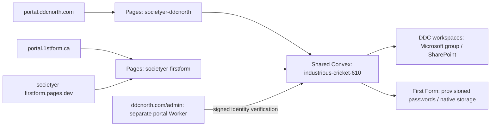

# DDC North and First Form: deployed setup

Verified November 8, 2026 (America/Vancouver). Use this page for the current
production configuration, the [operator runbook](operator-runbook.md) for
commands, and [lessons learned](lessons-learned.md) for the reasons and limits.
The feasibility review and October qualification records describe earlier states.

## One backend, separate workspaces and websites

| Resource | Current configuration |
| --- | --- |
| Shared Convex production | `industrious-cricket-610`, project `societyer-ddcnorth` |
| Application API / WebSocket | `https://industrious-cricket-610.convex.cloud` |
| Auth broker / HTTP actions | `https://industrious-cricket-610.convex.site` |
| DDC primary frontend | [portal.ddcnorth.com](https://portal.ddcnorth.com) |
| First Form primary frontend | [portal.1stform.ca](https://portal.1stform.ca) |
| DDC Pages project / alias | `societyer-ddcnorth` / `societyer-ddcnorth.pages.dev` |
| First Form Pages project / alias | `societyer-firstform` / `societyer-firstform.pages.dev` |
| Cloudflare account | `479e77f49d4ac5d7498529ee360f194b` |
| Old First Form backend | `elated-bee-460`; retained for rollback, old client identities locked out |
| Transfer rehearsal | `rapid-ox-123`; isolated copy, temporary deploy key revoked |
| Development | `gallant-anteater-27` (DDC), `reminiscent-marlin-243` (First Form); not repurposed |



The staff/client portal in `ddcnorth/portal` is a separate Worker with D1/R2 data.
It uses this broker for staff identity; it is not the Societyer workspace at
`portal.ddcnorth.com`. Its main-domain `/admin`, `/access` and other routes were
not moved by this consolidation.

Staff administration additionally checks its own approved Microsoft Object IDs
and administrator configuration. A Societyer Owner role or linked First Form
login does not grant staff administration. Offboarding must review that separate
allowlist as well as workspace memberships and broker sessions.

A domain selects presentation and the initial workspace. It never grants
membership. Authorization uses the verified login, membership, role, sign-in
policy and record ownership. Sharing Convex does not combine organizations or
automatically match people by email.

## Authentication and accounts

DDC retains its existing Microsoft tenant, approved group, certificate and
single-tenant registration. The redirect URI remains
`https://industrious-cricket-610.convex.site/api/auth/callback/microsoft`.
Adding a frontend domain does not change this backend callback. Registration
IDs, claims and certificate rotation are in the [Entra rollout](../ddcnorth-entra-rollout.md).

Both existing DDC workspaces have sign-in policy rows requiring Microsoft,
the configured tenant and the approved DDC group. Their normal login page shows
only **Continue with Microsoft**. An email-domain restriction is not a substitute
for directory/group evidence.

Group membership alone does not create an application account or workspace
membership. New directory members need explicit `entraProvisioning` registration;
its initial Viewer role can then be changed by an authorized workspace admin.
There is no SCIM or periodic directory synchronization in this setup. Profile
names are display data, not role evidence. The eight-hour app limit is not a
tenant-wide Entra Conditional Access change.

First Form retains separate, explicitly provisioned password logins and the
source memberships' Owner/Admin roles. Better Auth users, password hashes and
sessions were not copied. New destination logins were created, their exact IDs
recorded, and the imported memberships bound explicitly. No logins were matched
or linked by email. The Owner chose a new password and completed a real browser
sign-in; the Admin's own password setup remains an account-holder step. No setup
emails were sent by the migration.

The shared broker also offers Microsoft on First Form's login page. A DDC login
alone does not grant First Form membership. A person with two logins can use
**Link an existing account** after proving both. Roles and historical authorship
remain attached to their original memberships. A linked password session still
cannot open DDC; the actual session must carry Microsoft evidence. The DDC login
page offers a password form during the explicit linking flow only.

| Lifetime | Behaviour |
| --- | --- |
| Convex JWT | Five minutes; refreshes while the app session is valid |
| App session with Entra enabled | Fixed eight hours, including password sessions; refresh does not extend it |
| Cross-domain handoff | Same session and assurance; destination-held verifier, single-use short-lived code and exact mapped origins |
| Password setup/reset link | Single-use, one hour; choosing a password is followed by a separate sign-in |

See the [user guide](user-guide.md) for linking/switching and
[offboarding](operator-runbook.md#9-offboarding) for disabling membership and
revoking Microsoft sessions. JWT expiry, app-session expiry and membership
disablement are different controls.

## Shared server settings

| Setting | Current state / purpose |
| --- | --- |
| `AUTH_MODE` | `convex` |
| `SOCIETYER_PORTABLE_ACCESS_ENFORCEMENT` | `1` |
| `SOCIETYER_AUTH_MANUAL_PROVISIONING` | `1`; public sign-up closed |
| `SOCIETYER_ENTRA_LOGIN` | `1`; existing DDC Microsoft configuration retained |
| `SOCIETYER_ENTRA_SSO_REQUIRED` | Unset; DDC requirements are workspace policy rows |
| `SOCIETYER_AUTH_ALLOWED_EMAIL_DOMAINS` | Unset; deployment-wide `ddcnorth.com` would reject First Form |
| `SOCIETYER_AUTH_INSTANCE_NAME` | Unset; mapped origins display their workspace name |
| `SOCIETYER_AUTH_TOTP_ENROLLMENT` | `1`; workspace MFA policies remain separate |
| `SOCIETYER_DISABLE_NATIVE_FILE_STORAGE` | Unset; DDC's own rows disable native uploads |
| `SOCIETYER_STORAGE_PROVIDER` | Existing `sharepoint` default; explicit workspace rows select the intended provider |
| `SOCIETYER_INITIAL_INVOICE_TEMPLATE` | Unset; First Form's template is a workspace record |

`SITE_URL` contains these exact origins, comma-separated in the variable. DDC
stays first for existing fallback consumers:

```text
https://portal.ddcnorth.com
https://societyer-ddcnorth.pages.dev
https://ddcnorth.com
https://www.ddcnorth.com
https://societyer-firstform.pages.dev
https://portal.1stform.ca
```

The main DDC website origins remain trusted for staff admin integration. Every
origin above has an Active workspace mapping. First Form's custom domain is
primary and its Pages alias secondary, so new invitation/reset links use the
custom domain. Existing aliases are not forced through an HTTP redirect.

Mail, SharePoint, signing and meeting-transfer credentials remain server-only.
They are not `VITE_*` variables, DNS values or documentation examples. Public
production URLs are in `.env.ddcnorth` and `.env.firstform`; both name the same
backend. There is no new Microsoft registration or permission grant for the
First Form frontend domain.

## Branding and release ownership

DDC's workspace uses the kit from the private
[ddcnorth/design-system](https://github.com/ddcnorth/design-system) repository,
release `build-2-c10f81e799bc`, brand `ddcnorth` / `2.3-data-design-connection`.
The ZIP checksum was verified before import. The workspace saves a snapshot of
the imported profile and artwork; future design-system releases do not update
it automatically. Importing the kit did not replace every application font,
CSS file or React component. The kit's [consumption guide](https://github.com/ddcnorth/design-system/blob/main/docs/CONSUMING.md)
describes the broader package contents.

The DDC header shows the wordmark without a second visible workspace name;
accessible labels and picker names remain. Compact/sidebar and favicon artwork
uses the supplied six-dot symbols. `.env.ddcnorth` scopes symbol overrides to
the matching `ddcnorth` brand, so First Form does not inherit them. Source and
licence notes are under `public/ddcnorth`.

The separate staff admin in `ddcnorth/portal` shows plain `ddcnorth` in its brand
and name/role in the account area. Display name comes from the signed Microsoft
profile; tenant/group/Object ID checks establish authority. Its own
[cutover guide](https://github.com/ddcnorth/portal/blob/main/docs/CUTOVER.md) remains
the source for its D1/R2, mail and Worker configuration.

Societyer's two Cloudflare Pages projects use Direct Upload. A successful
GitHub check, push to main or GitHub Pages mirror release does not deploy hosted
Convex or these Cloudflare projects. Deploy the backend when needed, then the
intended frontend profile, and verify actual Cloudflare deployment metadata.
The separate `ddcnorth/portal` Worker has its own direct GitHub build connection;
do not confuse that workflow with Societyer's Pages releases. Shared production
includes the `documentSources` table and workspace brand fields.

## Storage and background work

Both DDC workspaces explicitly use `nativeUploads: "disabled"` and
`documentVersionProvider: "sharepoint"`. First Form explicitly uses `allowed`
and `native`. Its imported Convex file was copied and checksum-verified. DDC's
SharePoint connection and meeting-transfer Worker stayed on the same backend.
A native-storage workspace cannot allocate meeting-source uploads into DDC's
SharePoint through the meeting-transfer path.

Set an explicit storage policy before opening another customer's workspace.
The deployment still has a DDC SharePoint default; leaving a new workspace at
`deployment-default` is not a customer storage configuration. This remains an
operator onboarding task.

Native Convex attachments and native **document versions** are different paths.
Live native document versions additionally need a configured RustFS/R2 adapter.
Neither source First Form nor the shared backend had those adapter variables at
cutover. The policy preserves attachments; it does not provision that adapter.
A new live native document-version upload was not qualified.

Transferred workflows/schedules/senders and processor credentials follow the
[reviewed policy](../../shared/workspaceTransfer/policy.ts). Automations arrive
disabled where specified. Review credentials and enable them deliberately.
Vault metadata can move; source-encrypted secret values do not and must be
re-entered.

## End-user features and limits

- **My workspaces**, **Sign-in methods** and explicit account linking are live.
- **Request access** is available but remains off by default. Owners/Admins
  opt in and review requests. Requests cannot grant Owner; only an Owner can
  grant Admin. No live request/approver email was sent in this cutover.
- Operator inspect, unlink and duplicate-membership retirement are deployed.
  No real membership was retired or merged during this migration.
- Domain-specific AI connector URLs are:

  ```text
  https://industrious-cricket-610.convex.site/mcp/portal.ddcnorth.com
  https://industrious-cricket-610.convex.site/mcp/portal.1stform.ca
  ```

  Discovery metadata was checked. Consent must complete on the resource's own
  approved origin. Plain `/mcp`, or a client omitting its resource URL, can still
  fall back to DDC. Real third-party AI-client authorization remains unqualified.

Customers can use separate verified domains on this same backend. Domain
attachment, trusted origins, policy and canonical mapping are currently operator
tasks. A self-service **Connect your domain** screen, automatic DNS verification
and automatic customer policy provisioning are not implemented. The current
steps are in [domain onboarding](operator-runbook.md#4-domains).

## Release and transfer evidence

Shared-workspace features were already on main at `0135f7c8`. Configuration
commit `7071c7a1` was merged in [PR #77](https://github.com/ahzs645/societyer/pull/77)
as `fd6eeac6`. Both frontends came from the same clean source and followed the
backend deployment. Adding the custom domain reused First Form's existing build.

| Check | Observed result |
| --- | --- |
| Focused feature checks | 16 passed: transfer, identity tools, requests, linking, handoff, domain/storage/sign-in policy, MCP, auth and Entra |
| Builds | Both production builds and TypeScript passed |
| PR #77 | All six checks passed |
| Real rehearsal | 1,945 rows / 23 tables / one file; row/reference/file/financial verification passed; repeat apply inserted zero duplicates |
| Rehearsal preservation | All 174,517 existing DDC application rows identical |
| Production transfer | Final export verified; same row/file counts; finalized; explicit Owner/Admin bindings passed |
| Production preservation | 174,516 existing rows identical; remaining row changed only its live transcription-worker heartbeat |
| DDC access | Normal browser login Microsoft-only; Owner identity without Microsoft proof locked and direct read denied; real Microsoft session still resolved to Owner |
| Separate staff admin API | Real Microsoft Owner token accepted (200); real First Form password token denied (401) |
| First Form sign-in | Owner completed password setup and real browser sign-in; dashboard/Owner survived reload |
| New custom domain | Ownership and HTTPS active; Pages alias → custom domain handoff opened Owner dashboard without another login; clean URL and reload verified |
| Domain and storage audits | Passed |

Known `notification-settings` and standalone `check-export-coverage.ts` failures
reproduce on pre-cutover main. The latter concerns portable/archive export
lists, not the workspace-transfer policy/verifier. They were recorded, not
reported as passing. Not every acceptance journey was rerun; the
[acceptance matrix](acceptance-tests.md) distinguishes remaining work.

Pages deployment IDs: DDC `526172de-04c1-4cec-ae98-1c30e1794184`, First Form
`27bf4cc5-7acc-43fa-95b5-c91847866863`. Both succeeded with clean source metadata.
Later releases will replace these IDs.

## Backups, retained source and rollback

Old First Form remains intact. Its
`SOCIETYER_AUTH_ALLOWED_EMAIL_DOMAINS=cutover.invalid` blocks old client
identities and prevents writes from old builds. The inventoried source had no
API tokens or scheduled workflows to continue writing around that gate. This
source-specific freeze is not a general read-only mode for deployments with
service credentials or automation.

Encrypted database/file exports, environment rollback copies, plans, verify
reports and explicit identity maps are held outside Git in the private
`~/societyer-backups/shared-workspaces-20261108` directory. Its local README
explains decryption and recovery. Plaintext snapshots were removed after
encrypted copies were saved. Both temporary transfer keys were revoked and
their local copies removed. Setup links are private credentials, not repo docs.

Before `finalize`, `transfer:workspace abort` removes only its run's inserts.
After `finalize`, it refuses. After destination writes, reopening the source is
not a data rollback: reconcile those writes first. Never run a whole-snapshot
`--replace`/`--replace-all` import against shared production. Full replacement
was used only in the fresh isolated rehearsal.

For routine releases, use the explicit shared selector and `--codegen disable`
in the [First Form guide](../firstform-cloud-deployment.md). Do not restore the
former global SSO, email-domain or storage ceilings as a routine rollback:
those lock out First Form or override its storage policy.

